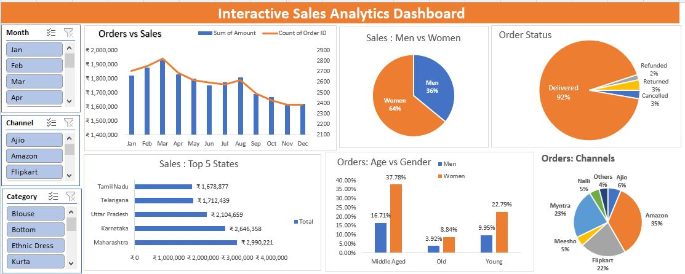

# Interactive Sales Analysis Dashboard Using Excel

## Project Overview

This project analyzes sales data using Microsoft Excel to identify sales trends, customer segments, and sales-channel performance. An interactive dashboard helps present important business insights for data-driven decision-making.

## Business Problem

Businesses need to understand customer purchasing behaviour, sales trends, and channel performance to improve sales strategies. This project analyzes sales records to identify important patterns and support better business decisions.

## Tools Used

- Microsoft Excel
- PivotTables and PivotCharts
- Charts and Slicers
- Data Cleaning
- Exploratory Data Analysis (EDA)
- Data Visualization
- KPI Reporting

## Data Preparation

- Cleaned and organized sales records for analysis.
- Reviewed customer, sales-channel, and transaction information.
- Prepared data for trend analysis and customer segmentation.
- Used Excel analysis features to summarize important sales metrics.

## Analysis

- Analyzed 31K+ sales records to understand sales patterns.
- Examined customer segments and purchasing behaviour.
- Compared sales-channel performance.
- Created an interactive dashboard using PivotTables, charts, KPIs, and slicers.

## Key Insights

- Women contributed approximately 64% of sales.
- Amazon, Myntra, and Flipkart together accounted for approximately 80% of orders.
- Customer segments and sales channels showed different contributions to overall performance.
- The dashboard made it easier to explore sales patterns and compare business performance.

## Business Recommendations

- Focus marketing campaigns on high-contributing customer segments.
- Evaluate the performance of major sales channels to improve sales strategies.
- Use dashboard filters to identify changing sales trends.
- Review customer purchasing patterns to identify opportunities for business growth.

## Dashboard Preview

Add a screenshot of your actual Excel dashboard here.

## How to Access

1. Open this GitHub repository.
2. Download the Excel workbook from the repository.
3. Open the workbook using Microsoft Excel.
4. Navigate to the dashboard worksheet.
5. Use the available slicers and charts to explore sales performance.

## Conclusion

This project demonstrates practical skills in Excel-based data analysis, data cleaning, customer segmentation, KPI reporting, and interactive dashboard development. The findings help explain customer contributions and sales-channel performance.

## Skills Demonstrated

Microsoft Excel, Data Analysis, Data Cleaning, EDA, PivotTables, PivotCharts, Data Visualization, KPI Reporting, Business Insights.

## Author

Venkata Sai Varma

GitHub: https://github.com/Varma1369

LinkedIn: https://www.linkedin.com/in/venkata-sai-varma-kanumuri-29b254274
